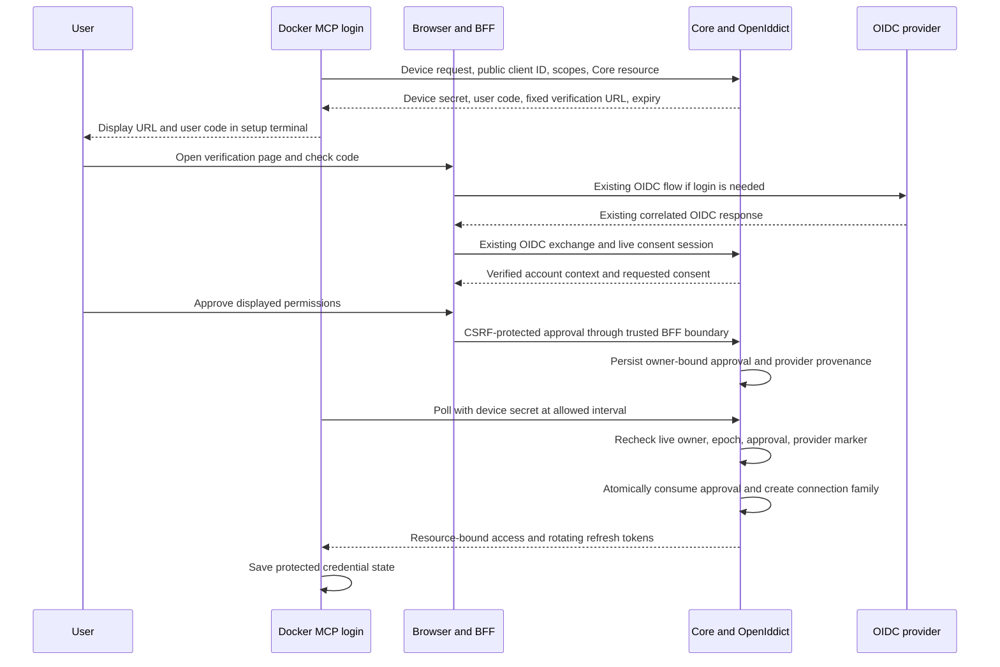

# ADR-016: MCP User Authorization and Core-Hosted Remote Access

**Date:** 2026-11-13
**Status:** Proposed
**Decision owner:** @jankahnt
**Tracking:** [#67](https://github.com/happticde/gamehub/issues/67),
[MCP Evolution](https://github.com/happticde/gamehub/issues/66)

GameHub should use Device Authorization Grant for its local Docker MCP and Authorization Code
with PKCE for remote MCP clients. Core should host a small OAuth authorization surface built with
OpenIddict. The future HTTP MCP should run inside Core so it can call tenant-scoped application
operations without forwarding tokens to another service.

This is a recommendation for review. No OAuth endpoints, dependencies, migrations, configuration,
or transport changes are implemented by this ADR. Acceptance must be recorded before the next
implementation package becomes Ready. Merge, release, and publication remain human-owned.

## Context and verified starting point

- `services/mcp/Program.cs` launches a stdio server. `CoreApiClient` sends a configured API key to
  Core. There is no user login, credential store, renewal, or HTTP MCP host.
- ADR-011's OIDC login runs through the Next.js BFF. Core independently validates provider proof
  and resolves the exact persisted issuer/subject mapping. This authenticates a user; it does not
  provide OAuth authorization endpoints for third-party MCP clients.
- Core already has `AccountSession`, account epochs, rotating `RefreshTokenSession` rows, and
  live session validation. Its web JWTs currently use a separate HMAC signing configuration and
  the default audience `GameHub.Clients`. They carry no MCP permission contract.
- ADR-015 maps one hashed provider session to one local family. Both the provider-session hash
  and its `AccountSessionId` are unique. Attaching another family to the same `sid` is therefore
  not an available reuse mechanism.
- Normal OIDC login already requires a provider `sid`. Local family revocation and provider
  logout differ: only provider logout or terminal deletion sets `ReissueBlockedAtUtc`.
- ADR-008 and ADR-010 through ADR-015 govern tenant isolation, provisioning, recovery, deletion,
  and logout. MCP must preserve those boundaries. OIDC and MCP must not enable guarded mode.

The [MCP authorization specification](https://modelcontextprotocol.io/specification/2026-07-28/basic/authorization)
applies to HTTP transports. Its OAuth handshake is not a stdio handshake. The local process
authenticates to Core independently and gets its credential-store location from process
configuration. Its stdio connection remains JSON-RPC only.

## Proposed decision

### 1. Separate primary login from delegated access

The configured external OIDC provider remains responsible for login, MFA, and recovery. The BFF
and Core retain their existing state, nonce, PKCE, ID-token, and issuer/subject checks. MCP clients
never receive the BFF service key, provider tokens, or a normal browser refresh token.

Core becomes the authorization server for narrowly scoped GameHub integration access. It owns
client registration, consent records, protocol tokens, and revocation. The browser's live GameHub
session authorizes consent through the BFF. The BFF forwards that session server-to-server; Core
revalidates it. A client ID, browser-submitted account ID, email, or provider role cannot select
the account or tenant. The request identifies an authorization transaction, not its owner.

The integration authorization surface is a separate, default-off capability. Enabling it requires
valid OIDC and its existing BFF trust, but does not change the guarded multi-user switch. Consent
requires a live browser family with a verified OIDC provider-session mapping, including for a
local account that was explicitly linked to OIDC. A mere external-identity link is insufficient
proof that a password-created browser session used OIDC. Existing guarded admission rules still
apply in either operator-selected mode.

Local password, operator-key, OIDC-link-only, and deletion-only tokens cannot approve MCP grants.
The existing API-key MCP mode remains an explicitly selected compatibility mode outside this new
flow. Authentication failure never switches to it automatically.

### 2. Use OpenIddict for protocol machinery

Recommend OpenIddict's server, validation, and EF Core integration inside Core. Keep its token and
authorization storage enabled. GameHub supplies consent and account/session policy; OpenIddict
supplies the protocol processing. Do not implement a second password system or copy a sample's
ASP.NET Identity registration UI. Do not replace the existing browser token service.

The stable baseline checked on 2026-11-13 is **OpenIddict 7.8.0**, released **2026-11-03**.
The official integration documentation lists .NET 10 support. Version 8 is still a preview in
the checked release list. Recheck stable versions, advisories, license notices, and transitive
dependencies before any package is added. This ADR adds none.
[Release](https://github.com/openiddict/openiddict-core/releases/tag/7.8.0),
[ASP.NET Core integration](https://documentation.openiddict.com/integrations/aspnet-core).

OpenIddict is a framework, not a ready-made MCP authorization product. Its upstream work for
[Client ID Metadata Documents](https://github.com/openiddict/openiddict-core/issues/2552),
[Dynamic Client Registration](https://github.com/openiddict/openiddict-core/issues/2404), and
[Protected Resource Metadata](https://github.com/openiddict/openiddict-core/issues/2400) was still
open when checked. Do not advertise those features as built in. The initial client policy uses
pre-registration. GameHub will provide its small protected-resource metadata document explicitly.

Before durable schema work, a bounded Docker feasibility PR must prove device approval, refresh
rotation/replay handling, explicit resource restriction, and coexistence with the current bearer
scheme on the chosen stable release. If this needs a protocol fork or relaxed validation, return
to this ADR. The proof must also identify the supported MCP SDK/client protocol versions.

### 3. Choose a flow for each transport

| Client | Flow | Reason |
| --- | --- | --- |
| Docker stdio MCP | Device Authorization Grant, RFC 8628 | The container can make outbound HTTPS requests but has no host browser or callback listener. No published container port is needed. |
| Future remote HTTP MCP | Authorization Code with PKCE `S256` | The MCP client can manage the browser redirect and authorization handshake. |
| Future native host helper | Reconsider browser PKCE if introduced | A host application with a reliable loopback callback has different constraints. It is not needed for the Docker path. |

Device login is an explicit setup command. It shows a verification URL and short user code in an
interactive terminal. Normal stdio startup never opens a browser, prompts for a password, or
waits for interactive consent. Missing authorization produces a sanitized setup error. Logs never
contain device codes, user codes, authorization codes, or tokens. The intentional terminal display
of a user code is not a diagnostic log.

RFC 8628 is suitable for clients without a usable callback. It does not replace browser PKCE for
native apps that can support it. [Device flow](https://www.rfc-editor.org/rfc/rfc8628),
[native app guidance](https://www.rfc-editor.org/rfc/rfc8252).

### 4. Register clients explicitly and grant minimal rights

- Pre-register `gamehub-mcp-stdio` as a public client. Enable device and refresh grants only.
  A public client ID identifies software; it is neither a secret nor proof of a genuine device.
- Pre-register each supported remote client with its exact redirect URIs, allowed resources,
  scopes, and grant types. Public clients have no embedded secret. Require PKCE `S256`, reject
  code reuse and wildcard redirects, and apply the native-loopback port exception only when
  explicitly applicable. Emit authorization-response issuer information and check it in clients
  that GameHub implements. Confidential clients use separately provisioned credentials.
- Default consent grants `library:read`. An explicit extra choice grants `tracking:write` for
  play status and rating. Requesting broader rights requires fresh consent. Device/code/refresh
  redemption cannot widen the original resource or scope set.
- `offline_access` requests renewal; it is not a library permission. Do not list it as a required
  protected-resource scope. No MCP grant authorizes sync, backup, credentials, linking, account
  management, or operator APIs.
- Check scope at the server operation, not just tool discovery. For the current REST path, allow
  only the five library reads used by MCP and the personal-status/rating update. The existing
  personal DTO also has `IsIgnored`; MCP credentials must not gain that mutation through a direct
  PATCH. Reject unsupported fields and keep ownership checks for every identifier.

Pre-registration is an intentional initial interoperability limit. Do not advertise CIMD or a
registration endpoint without implementing them. A client that requires automatic registration
is unsupported until a separate reviewed package adds it. Prefer CIMD when supported by the
selected stable stack; treat DCR as a compatibility option, not a prerequisite. Any metadata
fetching needs SSRF controls, bounded responses, safe redirects, and DNS/IP validation.

### 5. Bind tokens to one resource and keep HTTP inside Core

Use one configured public HTTPS issuer. It is a GameHub issuer, distinct from the upstream OIDC
issuer. An example deployment has these identifiers:

| Credential | Intended audience/resource | Accepted use |
| --- | --- | --- |
| Existing web JWT | Existing configured web audience | Existing BFF and account flows only; it does not become an MCP OAuth token. |
| Local MCP access token | `https://gamehub.example.com/api` | The explicit MCP REST operation allowlist in Core. This audience does not grant the whole API. |
| Remote MCP access token | `https://gamehub.example.com/mcp` | The HTTP MCP endpoint in Core. It cannot call the REST API with this token. |

These URLs are examples, not new environment settings. Exact issuer/resource values must come
from validated operator configuration, never a request Host header or tool argument. Require one
allowed resource per grant, and preserve it through device/code exchange and refresh. A missing,
unknown, or substituted resource fails closed. Do not issue a multi-audience shortcut token.

Recommend opaque reference access and refresh tokens for integrations. Core can validate them
against local protocol storage and live grant/session state. Protect persisted token payloads
using the library's supported encrypted format and separately protected persistent key material.
Do not assume every protocol payload is hash-only. Keep production keys independent from web
JWT, BFF, operator, and Ingest keys. Document rotation, backup, and restore; ephemeral development
keys are not a production strategy.

OpenIddict's default access-token validation does not check token-entry status on every request.
Enable token-entry and authorization-entry validation, plus GameHub's live account/epoch/family
check. A DB outage denies access; token lifetime is not a revocation substitute.
[Token storage](https://documentation.openiddict.com/configuration/token-storage),
[authorization storage](https://documentation.openiddict.com/configuration/authorization-storage).

Select allowed authentication schemes explicitly per endpoint. Do not route credentials by
unverified claims or let a failed integration token fall through to normal web/operator policies.
The existing web refresh and account-management routes exclude integration credentials.

For HTTP, extract the seven tool operations into a reusable application boundary and host the MCP
adapter in Core's process. Pass only the validated request principal into tenant-scoped operations.
Do not loop back through HTTP, invoke controllers as services, or copy their business logic. Keep
request state out of singleton tools. Test protocol-version negotiation and any older transport
session behavior separately from the durable authorization grant.

This removes the need for OAuth token exchange in the planned topology. An MCP-audience token
is consumed by the MCP endpoint and never forwarded to Core REST or Ingest. No shared service
credential impersonates the user. A separate remote host would require a new ADR for authenticated,
resource-limited delegation or token exchange before implementation.

### 6. Give every connection an independent, revocable family

An MCP connection means a durable user consent grant, not a TCP connection, MCP request, or
provider `sid`. Create one new `AccountSession` for each approved connection. Link it to exactly
one protocol authorization and a tenant-owned grant record with client ID, approved scopes,
resource, approval account epoch, creation/absolute-expiry time, and revocation state. Enforce
composite ownership keys. Renewal preserves the approved epoch; it never upgrades an old grant
to the account's current epoch.

OpenIddict owns integration refresh-token rotation. Do not create a parallel
`RefreshTokenSession` for the same credential or send integration refresh tokens to the existing
web refresh endpoint. Both token stacks share the live `AccountSession` and account epoch.
Extend central revocation and deletion to cover the new grants and protocol rows transactionally.

For provider logout, add an owner-constrained reference from the grant to the existing
`OidcProviderSession` that authenticated browser consent. Many grants may reference that row.
Do not move its one-to-one browser-family mapping, copy a raw `sid`, or invent a second mapping
from browser input. Consent requires the existing verified provider mapping to be live.

| Event | Required result |
| --- | --- |
| Revoke one MCP connection | Revoke its own family, grant, and protocol tokens. Preserve other connections and the browser family. |
| Local browser-family revocation | Keep independent MCP grants valid. This alone does not prove provider logout. |
| OIDC Back-Channel Logout with `sid` | Use the validated issuer-bound row and its provider-revocation marker to block all grants approved through that provider session. Preserve unrelated provider sessions. |
| OIDC logout with `sub` only, revoke-all, or password change | Existing account-epoch invalidation also blocks every MCP grant. |
| Pending/complete account deletion | Block use, approval, and redemption immediately; clean up grant/protocol ownership with existing deletion rules and retain required provider tombstones. |

Every token use and renewal also checks that the grant's provider row has no
`ReissueBlockedAtUtc`. Extend the provider-logout transaction to revoke the related MCP families
and protocol authorizations. This must work even if the original browser family was already
revoked locally. Order consent/redemption against the same provider marker and account epoch so
a logout cannot be followed by a surviving new grant. Do not advertise provider-session logout
support before these races and ownership checks pass on both database providers.

### 7. Bound renewal and store client credentials honestly

Recommend a ten-minute access lifetime and a thirty-day absolute renewal lifetime. These are
GameHub defaults, not protocol-mandated values. Refresh rotates the credential without extending
the grant's absolute end. Confirmed reuse revokes that connection's family and requires new login.
Treat a lost refresh response conservatively; do not add a broad token-reuse grace period.

The Docker default uses a dedicated named credential volume, separated by configured issuer,
resource, and connection ID. Use directory mode `0700`, file mode `0600`, the non-root runtime
user, atomic replacement, and a cross-process exclusive lock around read/refresh/write. Different
clients use different connections. No credential enters the image, arguments, checked-in config,
browser JavaScript, logs, or normal status output. Logout first revokes remotely, then removes
only the selected local credential. If remote revocation is unavailable, report that explicitly.
Use the library's OAuth revocation endpoint for client logout, bound to that client's credential
and grant. It does not authorize access to the browser's account/session-management APIs.

File permissions protect against other ordinary local users. **The volume is not encrypted by
this design.** Docker/host administrators and readable backups can obtain bearer credentials.
Host disk/backup encryption belongs to the operator. Do not place an encryption key next to the
token and claim extra protection. A host-keychain helper or external-secret-store integration is
a separate optional package; it is not required to run the current image. If encrypted client
storage is a deployment requirement, that package is a prerequisite for rollout there.

### 8. Keep public routing and resource limits explicit

Production device/token traffic uses HTTPS with normal certificate validation, including traffic
from the local container. A fixed public origin routes OAuth protocol endpoints and future
`/mcp` directly to Core. Consent pages remain in Next.js. Core stays private behind that proxy;
the plan does not expose all REST/operator routes. The local MCP's permitted REST routes must be
routed deliberately, without using the BFF's browser-cookie authentication adapter.

Trust forwarded scheme/host only from configured proxies. Reject unexpected Origin/Host values;
restrict CORS to the actual supported browser clients. Disabling HTTPS validation is not a Docker
workaround. Keep the existing local API-key development setup separate from production user auth.

Bound protocol bodies, pending requests, code guesses, polling, token work, and concurrent tools.
Use RFC 8628 polling/slow-down behavior and existing trusted rate-limit principles. Show the
intended GameHub instance, entered code, client identity limits, and permissions before approval.
Do not auto-approve a code supplied by an assistant; device-code phishing remains a real risk.

## Sequences

### Login and consent

For remote clients, the same consent and family rules apply to an authorization-code transaction.
The MCP client uses PKCE and the canonical `/mcp` resource. Only a short-lived authorization code
uses the registered callback. The code is consumed once at the token endpoint. Provider proof,
access tokens, and refresh tokens do not pass through browser JavaScript.

### Renewal and revocation

1. The local client acquires the credential lock and rereads the stored generation.
2. Core validates the refresh credential, original resource/scopes, grant expiry, live family,
   account epoch, deletion state, and provider-revocation marker.
3. Redemption and revocation serialize in the database. Rotation consumes one refresh token and
   persists its replacement. A losing transaction cannot revive a revoked grant.
4. The client atomically saves the replacement before releasing the lock. An uncertain response
   leaves no automatic write replay; recovery can require new login.
5. Revocation commits family/grant/protocol changes together. The next API/tool request or refresh
   rejects that connection. An already running operation is not rolled back automatically;
   sensitive writes need a final live check in their transaction to order against revocation.

## Threat and failure matrix

| Scenario | Required behavior and evidence |
| --- | --- |
| Guessed, expired, denied, or replayed device request | Bounded guesses/polling; terminal states and one-time redemption tested. No account discovery. |
| Approval under a different account or tenant | Owner comes from the live signed browser session. No request-provided owner selector; explicit current-account consent. |
| Wrong audience, upstream provider token, or web JWT at `/mcp` | Reject before tool execution. REST and remote audiences never substitute for one another. |
| Read-only token calls a write or unrelated REST route | Deny server-side, including direct PATCH with `IsIgnored` and normal account endpoints. |
| Foreign game, grant, or family ID | Tenant/account constraints and queries deny access without revealing another owner's data. |
| Refresh replay or two containers sharing state | Cross-process lock plus server single consumption. Confirmed reuse ends the family. Lost responses require safe recovery. |
| Logout races approval, redemption, refresh, or a write | Database ownership/marker/epoch checks serialize the result; committed revocation cannot be bypassed by a new credential. |
| Provider logout after local browser logout | Retained provider row blocks and revokes its derived grants; unrelated sessions survive. |
| Core DB/key storage unavailable | No token issuance or authorized execution. No API-key fallback or validation-cache grace. |
| Upstream OIDC unavailable | New browser authentication fails closed. Already issued local grants keep bounded local validity and revocation checks. |
| Invalid proxy origin, insecure URL, or redirect | Fail configuration/request validation. No credential forwarding or arbitrary return target. |
| Stolen local volume or backup | Bearer-token exposure is acknowledged. Per-connection revocation and absolute expiry limit persistence; permissions are not encryption. |
| HTTP disconnect, retry, or principal change | Request-scoped identity; no shared mutable principal, automatic write replay, or transport identifier used as authentication. |

## Alternatives and consequences

| Alternative | Assessment |
| --- | --- |
| Keep API keys or add personal access tokens | Smallest implementation, but manual secret handling and renewal fall short of the requested user-login experience. Retain only documented compatibility. |
| Browser PKCE inside the current Docker process | Good native-app default, but needs host callback routing/helper changes. Device flow fits the current no-port distribution. |
| Authenticate MCP directly at Keycloak or another upstream provider | Avoids a GameHub OAuth issuer, but couples clients to provider registration/scopes and still needs local account, tenant, session, and revocation binding. Does not remove this project's authorization work. |
| Hand-build device/code/token endpoints | Fewer packages but assumes ownership of security protocol behavior. Prefer a maintained framework plus explicit GameHub policy. |
| Add an independent authorization service now | Adds deployment and live-state coordination before they are needed. Revisit if Core must be split for operational reasons. |
| Keep the remote adapter in a separate process | Preserves the current REST proxy shape but introduces credential custody and authenticated delegation/token exchange. Co-hosting removes that boundary. |

The recommendation adds OAuth persistence, operational keys, protocol maintenance, and targeted
application extraction. It does not make authentication a small configuration toggle. Initial
remote support is limited to tested pre-registered clients. Client-volume encryption and universal
automatic client onboarding are not part of the default. These costs are explicit trade-offs for
one local authorization authority and reuse of the existing tenant/session boundary.

## Work-package changes after acceptance

Keep the [project](https://github.com/orgs/happticde/projects/2) order, with the following refinements.
These are proposed changes; downstream issues remain Backlog while this ADR is under review.

| Issue | Concrete scope and prerequisite |
| --- | --- |
| [#68](https://github.com/happticde/gamehub/issues/68) | Split out the bounded OpenIddict feasibility PR before the grant/schema PR. Recheck dependencies, then model one connection family, protocol authorization, resource, and owner-constrained provider provenance. |
| [#69](https://github.com/happticde/gamehub/issues/69) | Depends on #68. Add the explicit integration scheme, live grant/session/provider checks, exact REST allowlist, and status/rating field restriction. Ordinary account policies exclude integration credentials. |
| [#70](https://github.com/happticde/gamehub/issues/70) | Depends on #68/#69. Configure the library's device request/polling machinery, resource binding, and bounded abuse controls. Approval is still required before issuance. |
| [#71](https://github.com/happticde/gamehub/issues/71) | Depends on #69/#70. Add BFF consent and atomic approval/redemption. Include the provider-logout/epoch race barrier before any grant can be used. |
| [#72](https://github.com/happticde/gamehub/issues/72) | Depends on #71. Add explicit setup commands, isolated credential volume, permissions, locking, atomic writes, and truthful storage guidance. |
| [#73](https://github.com/happticde/gamehub/issues/73) | Depends on #69/#72. Implement integration-token use and rotation through the new protocol endpoint, separate from browser refresh. |
| [#74](https://github.com/happticde/gamehub/issues/74) | Move lifecycle enforcement into #68/#69/#71 as required. This package adds user-facing list/revoke UI and API, then completes individual/global/provider logout and deletion acceptance coverage. |
| [#75](https://github.com/happticde/gamehub/issues/75) | Depends on #71–#74. Verify local Docker login, restart, renewal, revocation, two-tenant isolation, database upgrades, and user/operator documentation. No automatic release. |
| [#76](https://github.com/happticde/gamehub/issues/76) | Depends on #75. Host HTTP in Core. Split application-operation extraction from transport wiring if they need separate PRs. Keep the endpoint private and fail closed. |
| [#77](https://github.com/happticde/gamehub/issues/77) | Depends on #75 and the feasibility proof. Configure code/PKCE, exact resource handling, and pre-registration. No implicit commitment to CIMD/DCR. |
| [#78](https://github.com/happticde/gamehub/issues/78) | Depends on #76/#77. Add protected-resource metadata, authorization discovery, minimal scopes, and correct challenges. Advertise only proved capabilities. |
| [#79](https://github.com/happticde/gamehub/issues/79) | Depends on #69/#76–#78. Verify audience-specific validation and in-process tenant operations. No forwarding or token-exchange implementation is needed in this topology. |
| [#80](https://github.com/happticde/gamehub/issues/80) | Depends on #78/#79. Test at least two agreed pre-registered clients and document actual SDK/protocol/client versions, HTTPS topology, limits, and manual release steps. |

Each security boundary ships with its negative and race tests, not just a final audit. Required
ownership, migration, and concurrency checks cover SQLite and PostgreSQL. Each PR records executed
checks and skips. Keep one package active, and preserve the checked commit, current state, and
next step in its issue/PR when pausing. A size label is not a subscription-window guarantee.

## Review and implementation gates

1. Review and record acceptance of this proposed design, including the plain permission-protected
   credential volume, pre-registered remote-client limit, and Core-hosted HTTP topology.
2. Revise and split the downstream issues as above. Complete the stable-library feasibility proof
   before a schema or production dependency commitment. Failure reopens the architecture choice.
3. Verify the local gate before claiming OIDC-backed Docker MCP support. Verify the remote gate
   before exposing HTTP or claiming client interoperability. Keep guarded mode operator-controlled.

## Further references

- [ADR-008: Tenant isolation requirements](008-data-portability-format.md)
- [ADR-010: Account lifecycle](010-account-lifecycle.md)
- [ADR-011: Production OIDC authentication](011-production-oidc-authentication.md)
- [ADR-012: Guarded enablement](012-guarded-multi-user-enablement.md)
- [ADR-013: Personal-tenant provisioning](013-personal-tenant-oidc-jit-provisioning.md)
- [ADR-014: Human-confirmed physical capture](014-human-confirmed-physical-game-capture.md)
  remains outside the MCP permission set.
- [ADR-015: Session and provider logout](015-oidc-back-channel-logout.md)
- [OAuth security best current practice, RFC 9700](https://www.rfc-editor.org/rfc/rfc9700)
- [Resource indicators, RFC 8707](https://www.rfc-editor.org/rfc/rfc8707)
- [Protected resource metadata, RFC 9728](https://www.rfc-editor.org/rfc/rfc9728)
- [OpenIddict key management](https://documentation.openiddict.com/configuration/encryption-and-signing-credentials)
