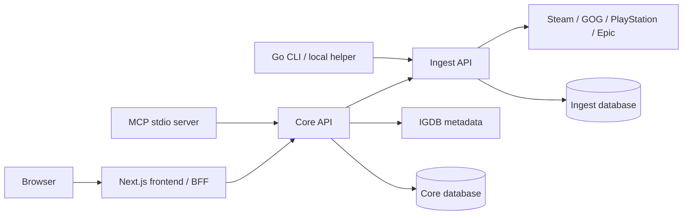

# Architecture

GameHub separates provider-facing ingestion from the unified collection and browser session.

## Components

| Component | Responsibility | Source |
| --- | --- | --- |
| Core | Unified games, matching, enrichment, accounts, tenant library state, orchestration | `services/core/` |
| Ingest | Raw platform data, provider retrieval, encrypted credentials, export | `services/ingest/` |
| Frontend/BFF | User interface, OIDC browser flow, HttpOnly sessions, authenticated Core proxy | `frontend/` |
| CLI/helper | Compatibility ingestion and visible local provider connection | `services/cli/` |
| MCP server | Stdio tools backed by Core | `services/mcp/` |
| Shared | Cross-service contracts and infrastructure | `services/shared/` |

## Data flow

Retrieval stores provider data in Ingest. Core exports those records and matches them by
normalized title slug into tenant-owned unified games and platform library items. Manual
merge/split links override that matching durably. IGDB enrichment adds metadata independently
of platform ownership. Physical copies are separate owned records on unified games.

Cached synchronization never contacts providers. Refresh-if-stale performs retrieval where
needed before synchronization. Provider freshness advances only for completed retrievals;
partial failures do not advertise fresh data.

## Trust and ownership

Core resolves the active tenant from trusted authentication claims. Core-to-Ingest delegation
uses an independent service key and a trusted tenant boundary. Normal client headers do not
select a tenant. Query filters, write guards, composite relationships, and database constraints
work together; hiding foreign data in the UI alone is insufficient.

Browser access/refresh tokens remain in HttpOnly cookies. Stored provider credentials are
encrypted in Ingest with versioned AES keys. The BFF owns OIDC correlation; Core independently
validates provider identity and maps exact issuer/subject to an existing account or an explicitly
permitted personal-JIT lifecycle.

See [OIDC architecture](../oidc-authentication-architecture.md),
[tenant isolation audit](../tenant-isolation-audit.md), and the
[ADRs](../adr/001-server-side-retrieval.md) for implementation detail and historical decisions.
Older ADR context describes the state at that decision's date; consult its implementation
updates and current operator guides before applying historical limitations.

## Build and release boundaries

Core, Ingest, frontend, and CLI share one product version. CI selects affected checks from the
complete Git path comparison and fails conservatively when that comparison is unavailable.
Release publication is manual and runs full verification. Documentation has independent npm
dependencies and is published manually without producing application images or a product release.
