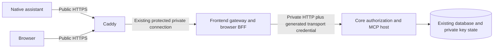

# Minimal MCP deployment and native-client contract

**Status:** Accepted amendment to [Architecture Decision Record (ADR) 016](adr/016-mcp-user-authorization.md),
through human-merged [#115](https://github.com/happticde/gamehub/pull/115) at `5be04c2`.
**Decision owner:** @jankahnt. **Task:** [#112](https://github.com/happticde/gamehub/issues/112).
**Setup release:** [Simplified setup](https://github.com/happticde/gamehub/milestone/4), acceptance
[#118](https://github.com/happticde/gamehub/issues/118).
**Later remote release:** [Remote access](https://github.com/happticde/gamehub/milestone/2), acceptance
[#80](https://github.com/happticde/gamehub/issues/80). Native remote clients are outside the setup release.

Select one public Frontend gateway, the existing private Docker service network, automatically
provisioned durable keys, and automatic identification of two named native clients. Core remains
the authorization server and hosts the remote [Model Context Protocol (MCP)](https://modelcontextprotocol.io/)
adapter and tenant-scoped operations in its own process. This is a delivery contract, not an
installation guide for the current release. Commands, files and new routes below must be shipped
and verified by the linked tasks before operators use them.

Owner review and merge of #115 accepted two changes to ADR-016: private Frontend-to-Core HTTP replaces the
extra internal HTTPS listener, and restricted Client ID Metadata Documents (CIMD) replace mandatory
remote pre-registration. The original decision applies with those amendments. Acceptance does not
itself implement the runtime or authorize deployment, publication or enablement.

## Starting point and operator work

The baseline is an existing single-host Docker Compose installation with working external
[OpenID Connect (OIDC)](https://openid.net/specs/openid-connect-core-1_0.html) sign-in, secure browser
cookies, and Caddy on a separate server. Its existing Caddy-to-Frontend connection must already be
restricted to the trusted proxy and protected by the installation's trusted private network or
encrypted tunnel. An untrusted LAN is not a substitute. This proposal adds no new cross-host hop.
Deployments without that baseline must secure their existing website path first.

Reviewed source baseline: `d5b2f2a`. The uncommitted
[#111 evidence](https://github.com/happticde/gamehub/issues/111) describes the manual setup; it is
not an implementation dependency and remains subject to the user's proofreading boundary.

| Operator responsibility | Manual baseline in #111 | Selected delivery |
| --- | --- | --- |
| New non-secret inputs | Public hostname, private addresses/port, several matching URLs and switches | Explicit enablement and one canonical public GameHub origin |
| Setup files | Hand-written generator, Compose addition, private files, Caddy trust file | One shipped `compose.mcp.yaml`; setup writes protected state in named volumes |
| Keys and certificates | OpenSSL commands, independent protocol certificates, private certificate authority and HTTPS certificate | Setup generates independent protocol/protection keys and internal credentials; no internal certificate authority |
| Service trust | Copy one secret into Compose; copy trust certificate to Caddy and Frontend | Setup writes separate permission-protected copies for each service; no manual secret transfer |
| Routing | Extra Core HTTPS listener, private published port, Docker hostname alias, Caddy Core routes | Existing Caddy upstream stays Frontend; one site edit blocks private paths and strips internal headers |
| Issuer/resource addresses | Repeat issuer, public origin, REST resource, consent destination | Derive from canonical origin and existing private Core destination |
| Client login | Client Docker image, persistent volume and explicit device setup | Native remote URL and browser authorization, independently for each client |
| Maintenance | Operator renews HTTPS and protocol certificates, preserves keys | Service manages protocol-key lifecycle; operator preserves state/backups and responds to readiness failures |

Public HTTPS, provider login, consent, isolated grants, resource binding and persistent token
protection are requirements. A second TLS listener, private certificate authority, network alias,
manual shared-secret duplication and client-side Docker are deployment choices, not requirements.

## Topology and transport trust



The browser backend, or [Backend for Frontend (BFF)](https://learn.microsoft.com/azure/architecture/patterns/backends-for-frontends),
continues to own browser cookies. A separate, fixed-route gateway in the same Frontend process
relays MCP protocol traffic without reading cookies, translating browser authentication or adding
an operator key. It forwards the assistant's bearer token only to Core's matching protocol/resource
endpoint. Core consumes remote MCP tokens in process; it never forwards them to REST or Ingest.

The gateway constructs its destination from the existing trusted server-side `CORE_URL` and a
compiled path/method allowlist. Requests cannot supply a destination, owner, tenant or trust anchor.
It strips incoming internal credentials, forwarding headers and cookies, then inserts a generated
`X-GameHub-Mcp-Transport-Key`. It validates the public host against the configured origin and rejects
unexpected browser Origins. A browser consent request uses the separate server-only consent path,
live browser access token, existing cross-site request-forgery protection and independent
`X-GameHub-Mcp-Bff-Key`; public gateway routes must never insert that consent credential.

Before protocol authentication, Core requires a valid transport credential on gateway traffic.
Only after that check does it restore `Request.Scheme=https` and the canonical public authority
from validated configuration. It does not trust caller-selected `Host`, `Forwarded` or
`X-Forwarded-*` values to select that authority. Private consent also requires its independent
credential and the signed browser principal. Neither service credential authorizes a tool or
chooses an account. Missing, duplicated or wrong credentials fail closed before protocol work.

Keep OpenIddict's HTTPS requirement enabled; its
[reverse-proxy guidance](https://documentation.openiddict.com/integrations/aspnet-core#transport-security-requirement-client-server)
requires restoring the original secure request context. Do not call
`DisableTransportSecurityRequirement()`, disable certificate validation or set a global trust-any-proxy
policy. Direct legacy HTTPS deployments keep their separately validated configuration path.

Private HTTP is confined to trusted processes on one GameHub host. Host/Docker administrators can
read this traffic and mounted secrets; an internal bearer credential provides admission, not wire
encryption. Core's existing loopback binding remains private; no new Core port is published.
Caddy must have no route or network access that exposes Core directly. Compromised Frontend was
already within the browser-token trust boundary; the new gateway also handles assistant tokens.
Do not cache, log or retain those tokens. This explicit trust trade-off needs owner approval.

The gateway must stream responses and propagate cancellation and backpressure. It may not buffer
event streams, replay requests, follow upstream redirects, or convert protocol errors into browser
login redirects. Only validated authorization redirects reach the browser. Upstream failures
produce sanitized protocol errors. Dedicated route handling must precede browser-login middleware;
unauthenticated discovery and OAuth requests must remain reachable without a browser cookie.

| Alternative | Decision |
| --- | --- |
| Keep manually managed internal HTTPS | Preserves current transport, but fails the certificate/trust-copy and input budget. Keep as an explicit legacy path. |
| Automate that private certificate authority | Hides some commands but retains extra listener, Caddy trust distribution and expiry coordination. Reject as the default. |
| Frontend calls Core through public Caddy | Avoids a private certificate but adds hairpin routing and makes private consent publicly addressable. Reject. |
| Add another gateway/authorization service | Adds a process, credentials and lifecycle coordination. Existing Frontend/Core roles suffice. |
| Reuse the private service boundary | Select, with authenticated canonical-context restoration and strict public/private route separation. |

## Exact route contract

Let `O` be the canonical origin, for example `https://games.example.com`, without a trailing slash.
Derive issuer `O/`, local REST resource `O/api`, and remote resource `O/mcp`. These identifiers stay
distinct. The origin must match the working browser/provider callback origin, differ from the
provider's own origin, and contain no user information, path, query or fragment. An explicit
non-default HTTPS port is part of the authority and must match everywhere.

| Public path/method | Destination and rule |
| --- | --- |
| `GET /.well-known/oauth-authorization-server` | Core metadata for issuer `O/`; advertise implemented capabilities only |
| `GET /.well-known/oauth-protected-resource/mcp` | Core metadata for exactly `O/mcp`; initial read permission only |
| `GET /connect/authorize` | Core code/PKCE validation; short-lived transaction leads to Frontend consent |
| `POST /connect/device`, `/connect/token`, `/connect/revoke` | Core's bounded protocol processing; preserve existing device behavior |
| `GET /mcp/verify`, `GET /mcp/authorize` | Frontend browser pages; existing sign-in and live session checks |
| `GET`, `POST`, `DELETE /mcp` | Core remote transport when enabled; token and negotiated transport rules still apply |
| Existing allowed `/api/library` operations | Dedicated local-token gateway allowlist only; retain #69's exact methods, fields and paths |
| Existing `/api/core/*`, browser login/callback and provider logout | Existing browser BFF behavior; no generic assistant-token adapter |

The managed gateway serves both discovery documents through the existing Caddy upstream. An
unauthenticated request to the transport receives a `Bearer` challenge with the protected-resource
metadata URL and `library:read`. A rejected bearer token adds `invalid_token` to the 401 response.
A valid remote identity missing the read permission receives 403 with `insufficient_scope`.
Authorization-server metadata describes the bounded Codex and Hermes client documents, the code
flow with `S256`, and the optional `tracking:write` and `offline_access` scopes. Public discovery
requires no credentials. Basic resource access requires `library:read`. The advertised issuer is
exactly `O/`, matching the native authorization response. The shipped Caddy rules still gate remote
login and transport until #80.

The private `/mcp` route uses the MCP C# software development kit (SDK) in Core. It runs one
server context per request and has no transport session identifier to share, expire, or restore
after a restart. The SDK accepts legacy initialization and current discovery. Streaming responses
and request cancellation use the existing gateway. The shipped Caddy site returns 404 for
`/mcp` while remote authorization is pending. Core independently denies remote authentication
even for requests bearing the generated gateway credential. The existing Docker client keeps its
separate REST resource and grant.

Core can stage the remote browser flow through the managed gateway. OpenIddict stores an
encrypted, five-minute authorization request and issues a two-minute authorization code after
the account approves it. The browser continuation carries only a request reference. An approval
is bound to the displayed account and its verified provider session. The callback receives the
code, original state, and exact issuer after Core commits the decision. The shipped Frontend
and Caddy block the public authorization entry point until the remote release gate.

`/connect/verify` and the new `/connect/authorize/consent`, including trailing-slash/subpath variants,
are private server-to-server paths. They return 404 at the public edge and have no public gateway
handler, even if Caddy is misconfigured. Core still requires service trust plus verified owner proof.
All other `/connect/*`, metadata aliases, and generic Core/operator routes are excluded unless
explicitly listed by a later reviewed contract. No public registration endpoint is selected.

Authorization-code consent binds a server-persisted transaction to the verified browser owner,
client, exact callback, PKCE `S256` challenge, resource and approved scopes. A one-time confirmation
is bound to that owner; switching accounts, changing the transaction or replaying confirmation
requires a new preview. Core revalidates live provider provenance and grant admission transactionally
on approval and redemption. Only the short-lived code is redirected to the registered client;
provider tokens and browser credentials stay on the existing server-side path. Authorization
responses include the exact issuer through the
[RFC 9207 `iss` parameter](https://www.rfc-editor.org/rfc/rfc9207).

The one Caddy site change keeps the existing Frontend destination and timeout settings. It adds
private-path rejection, strips both internal key headers from public requests, and sets the
upstream Host to the site's configured canonical authority. It must preserve streaming and avoid
logging protocol queries, authorization headers or request/response bodies. #114 ships the complete
site example; no Caddy-side MCP secret, trust file, new upstream or private-address input is needed.

## Operator input, file and command contract

#114 ships one `compose.mcp.yaml` alongside both the source and published-image deployment files.
It extends the current `core` and `frontend` services, adds an on-demand `mcp-setup` service, and
declares project-scoped persistent volumes. The setup service reuses the matching Core release/build;
there is no always-running fourth application service or client Docker requirement.

From the existing installation directory, using the existing project name and base Compose file,
the sole initial MCP setup command is planned as:

```bash
docker compose -f compose.yaml -f compose.mcp.yaml run --rm --no-deps mcp-setup \
  --enable --public-origin https://games.example.com
```

For a repository installation, the base file is `docker-compose.yml`; for the repository's image
entry point it is `docker-compose.images.yml`. This is the existing deployment selection, not a
new MCP setting. Source setup uses the same supported Compose build mechanism as Core; published
setup uses its selected release tag. No download from an unpinned development branch is required.
The command prepares state and prints a sanitized readiness report. It does not start/recreate
application services, edit Caddy, contact a real provider, or enable public remote exposure.
Normal deployment/recreation and Caddy validation/reload remain explicit operator actions, using
the same Compose addition thereafter. Those routine deployment commands are not hidden setup work.

| Managed state | Access and persistence |
| --- | --- |
| `mcp_core_state` volume: versioned configuration, signing/encryption/protection certificates and data-protection ring | Core only; setup provisions ownership, Core manages rotation and ring writes |
| `mcp_frontend_state` volume: versioned non-secret origin/configuration plus dedicated transport/consent credentials | Frontend read-only; setup owns updates; never contains Core's private certificates |
| Matching transport/consent credentials in Core state | Generated once, independent from each other and every existing service/JWT/provider key; no manual copy |
| Existing Core database and application volumes | Remain in the same Compose project; grants/protocol rows and browser/provider state are preserved |

Managed files load through dedicated server-side configuration loaders, not generated environment
files or secrets in container arguments. Each service sees only its own files; private directories
use mode `0700`, private files `0600`, and the image's actual non-root identity. Setup must not
assume equal Frontend/Core user IDs or print a merged Compose configuration containing secrets.
Both copies carry one generation ID; Core and Frontend fail readiness on a partial/mismatched
generation. Setup refuses symlinks, partial/ambiguous state and concurrent mutation. Repeating the
same command validates existing state; it never silently replaces keys, changes origin or destroys
grants. Conflicting manual/generated configuration fails with an actionable error.

Only explicit enablement and canonical public origin are new non-secret inputs. Existing provider,
database, proxy-network and service settings are validated/reused. Issuer, resources, consent URLs,
key paths, gateway destination and paired credentials are derived or provisioned. Default-off
switches and the operator-selected guarded multi-user mode remain unchanged until an intentional
deployment. Remote exposure remains closed until #80's acceptance and human enablement.

## Native clients and registration decision

Research date: 2026-11-16. These are **source-reviewed target versions**, not a claim of tested
GameHub remote interoperability or support for every newer/older version:

| Client | Evidence and selected profile |
| --- | --- |
| Codex CLI **0.169.0**, released 2026-11-13 | [Release](https://github.com/openai/codex/releases/tag/rust-v0.169.0), [registration source](https://github.com/openai/codex/blob/rust-v0.169.0/codex-rs/rmcp-client/src/oauth_client_registration.rs). Select its stable `https://chatgpt.com/oauth/codex/client.json` identity by advertising issuer-bound responses, CIMD and public-client authentication `none`. Its loopback `/callback` uses a dynamically selected port. |
| Hermes Agent CLI **0.23.1**, released 2026-11-10 | [Release](https://github.com/NousResearch/hermes-agent/releases/tag/v0.23.1), [login source](https://github.com/NousResearch/hermes-agent/blob/v0.23.1/tools/mcp_oauth.py), [metadata](https://github.com/NousResearch/hermes-agent/blob/v0.23.1/website/static/oauth/client-metadata.json). Select `https://nousresearch.github.io/hermes-agent/docs/oauth/client-metadata.json`; its default native flow uses `/callback` at loopback ports 27890–27894. The release's [MCP dependency](https://github.com/NousResearch/hermes-agent/blob/v0.23.1/pyproject.toml) is Python `mcp==2.3.0`. |

The [Codex guide](https://developers.openai.com/codex/mcp) and
[Hermes guide](https://hermes-agent.nousresearch.com/docs/user-guide/features/mcp) confirm automatic
CIMD with dynamic-registration fallback. Mandatory pre-registration adds a client ID to user setup
and therefore misses the requested input budget. Select CIMD for these two exact identities;
do not advertise [Dynamic Client Registration](https://www.rfc-editor.org/rfc/rfc7591), arbitrary
metadata URLs, callback-specific Codex metadata identities or generic hosted-client support.
OpenIddict is still the protocol engine; #77 adds the bounded metadata admission adapter, not a
second authorization protocol. No unsupported built-in OpenIddict CIMD feature is assumed.

Fetch only those two exact HTTPS metadata URLs, with normal certificate validation, no redirects,
cookies or credentials, a five-second deadline and a 16 KiB response bound. Reject non-public
resolved addresses and bind validation to the actual connection to prevent DNS rebinding. Cache
only validated documents, for at most one hour and no longer than their HTTP cache policy; absent
or expired valid metadata blocks new authorizations. Require self-matching `client_id`, valid JSON,
public-native code/refresh metadata and the supported callback profile. Do not fetch logos or other
document-supplied URLs. Bound concurrent fetches and negative-cache failures; unknown IDs cause no
outbound request or database write. Metadata changes cannot widen the compiled callback profile.
Renewal of an existing grant uses its stored validated client/resource binding and live revocation
checks; it does not depend on refetching public metadata on every token use.

For Codex, allow only the metadata's exact loopback host and `/callback` path with the native
ephemeral-port exception from [RFC 8252](https://www.rfc-editor.org/rfc/rfc8252#section-7.3).
For Hermes, preserve its explicit listed ports and exact host/path. Neither profile permits user
information, query, fragment, wildcard host/path or a remote HTTPS callback. Code exchange must
match the complete redirect URI captured on the transaction. Client metadata identifies software,
not a trusted user or an unforgeable installation; display that limitation before consent.

Target user configuration after delivery:

```toml
[mcp_servers.gamehub]
url = "https://games.example.com/mcp"
```

Run `codex mcp login gamehub`, then use the client browser login and read-only consent.

```yaml
mcp_servers:
  gamehub:
    url: "https://games.example.com/mcp"
    auth: oauth
```

Run `hermes mcp login gamehub`, then use browser login and consent. No client ID, shared secret,
copied bearer token or Docker bridge is required. The first acceptance target is the native CLI
running where its browser can reach its loopback callback. Hermes desktop/dashboard callbacks,
headless gateways and remote SSH callback routing require separate profiles; they are not silently
covered by this claim. If the owner requires those surfaces for this release, decide the callback
policy before implementation rather than adding public wildcard redirects.

The [current MCP registration rules](https://modelcontextprotocol.io/specification/2026-07-28/basic/authorization/client-registration)
define CIMD and registration selection. #80 must record the actual negotiated MCP revision and
both executable versions; source inspection and an HTTP 200 metadata fetch are not native login
acceptance. Both metadata URLs were reachable with matching client IDs during research; Hermes'
published document matched the release source. No real user/provider authorization was performed.

## Persistence, maintenance and migration

The [managed-key interface](mcp-managed-keys.md) documents #113's store layout, private commands,
retention, adoption and recovery. Human-merged #114 supplies Compose/configuration integration.

#113 generates three independent durable protocol/protection certificates, independent internal
credentials, and a persistent data-protection ring. No internal TLS certificate is needed for the
selected topology. Provisioning is atomic, locked, and idempotent; missing or corrupt existing key
material fails closed. The running Core key manager renews before expiry, keeps old signing and
encryption keys through the last dependent token lifetime, and retains protection decryptors until
every dependent data-protection key is safely rewrapped. Readiness reports expiry/rotation failures
without exposing key paths, values, identities or tokens. No unattended trust deletion is allowed.

Preserve both managed volumes and a consistent Core database/key-ring backup across upgrades and
container recreation. Backups require operator-controlled encryption and access restrictions.
Losing protection/encryption state can make existing grants unrecoverable; restoring only the
database is insufficient. Document revocation and fresh authorization after unrecoverable loss;
never regenerate replacement keys under a seemingly healthy installation. Ordinary key lifecycle
is automatic; disaster recovery and deliberate trust rotation remain explicit maintenance.

For existing manually provisioned installations, keep the legacy path until an operator schedules
migration. The same setup entry point offers explicit `--adopt-existing` using documented read-only
mounts for the existing certificate/ring files and dedicated secret input files. It validates and
imports existing protocol keys, protection decryptors, ring application identity and origin without
printing secrets, regenerating keys or reading environment files. Migration-specific file mounts
are an acknowledged one-time exception to the fresh-install input budget. If safe adoption cannot
be proved, stop and retain the legacy configuration; do not silently log out all connections.

After a consistent backup and verified import, the operator replaces the old MCP override with the
single shipped addition, uses the generated Frontend-only Caddy site, and removes the obsolete Core
listener/alias and certificate trust mounts only after successful checks. Existing databases,
Compose project/volumes, issuer, REST audience and grant identities remain unchanged. Test rollback
before allowing remote grants that an older release cannot understand. Retain old private material
until the verified rollback window ends; never delete it as part of setup.

## Delivery and acceptance boundary

| Task | Required evidence before its handoff |
| --- | --- |
| [#113](https://github.com/happticde/gamehub/issues/113) | Fresh/repeated/concurrent/partial setup; independent keys and least-privilege mounts; restart, expiry/renewal, retention, consistent backup/restore and explicit legacy adoption on SQLite/PostgreSQL; no secret output. |
| [#114](https://github.com/happticde/gamehub/issues/114) | One shipped addition and setup command for source/images; both service loaders; authenticated context restoration without disabling HTTPS enforcement; actual native Node transport; separate-host Caddy fixture; denied private routes/direct spoofed headers and wrong generation; unchanged browser/provider access and Compose storage. Replace #111's manual handbook path after its review boundary. |
| [#76](https://github.com/happticde/gamehub/issues/76) | Private Core-hosted transport and request-scoped application operations; gateway streaming/cancellation and route precedence; no retry of writes or HTTP loopback from tools. |
| [#77](https://github.com/happticde/gamehub/issues/77) | Exact two-client metadata admission, connection-bound public-address validation, redirects/cache/fetch bounds, callback validation, code/PKCE/resource/issuer response, one-time owner-bound consent and refresh replay rejection. No arbitrary registration endpoint. |
| [#78](https://github.com/happticde/gamehub/issues/78) | Canonical discovery and challenges through Caddy; correct read scope, issuer `iss` support and actual CIMD capability; Host/forwarded input cannot change advertised URLs. |
| [#79](https://github.com/happticde/gamehub/issues/79) | Two-owner reads/writes, exact resources and fields, provider/global/individual revocation and races, transaction ordering, independent families and no REST/Ingest token forwarding. |
| [#80](https://github.com/happticde/gamehub/issues/80) | Fresh operator attempt within the stated input/file/command budget; both named actual CLIs perform browser login, reads, separately approved writes, renewal/reconnect and isolated revocation; recorded versions/protocol, recreation/migration and all required checks for the exact main candidate. |

Read-by-default consent, separately approved tracking writes, existing tenant/account ownership,
provider-session provenance, deletion, independent connection revocation and API-key separation
remain mandatory. No multi-user switch is enabled by setup. The
[ADR-008 isolation requirements](adr/008-data-portability-format.md#multi-tenancy-compatibility) and
[guarded enablement](adr/012-guarded-multi-user-enablement.md) still apply. New security behavior
ships with negative/race tests in its owning task on both database providers.

Approval here selects a bounded implementation path. Failure to meet it is an explicit owner
decision, not permission to add manual certificates, extra client secrets, wildcard callbacks or
another prerequisite project. The owner separated publication on 2026-11-17: human-merged #112–#114
ship through the standalone [setup acceptance](mcp-setup-release-gate.md), without waiting for
#76–#80. The existing Docker client remains its user connection path. The native-client sections
above are requirements for the later remote release, which remains **Not ready** until #80 passes.
Each gate records its own exact candidate and checks; setup readiness is maintained in #118.
The user owns merges, the manual Release workflow, documentation publication and enablement.
