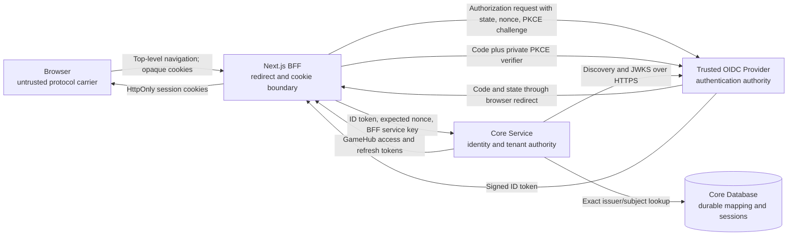
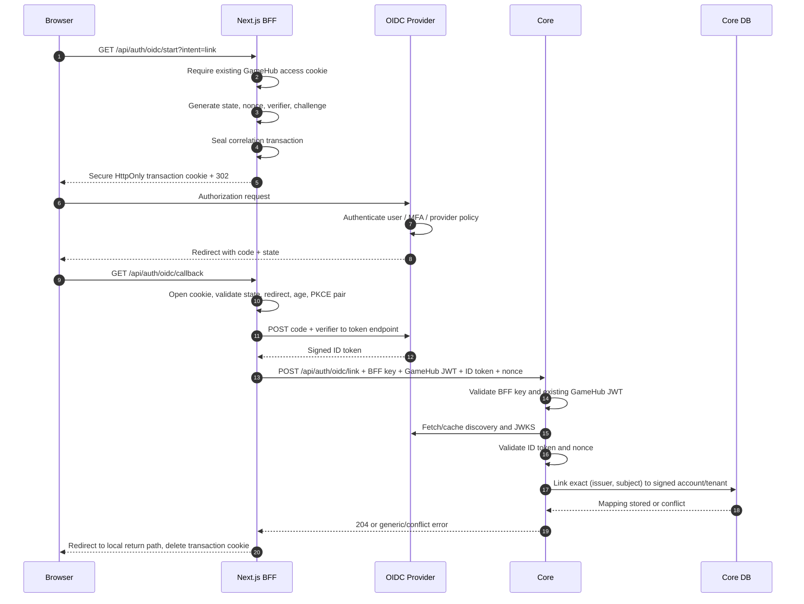
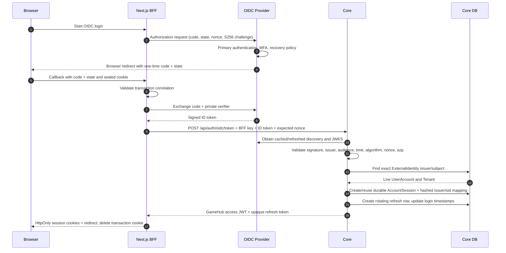
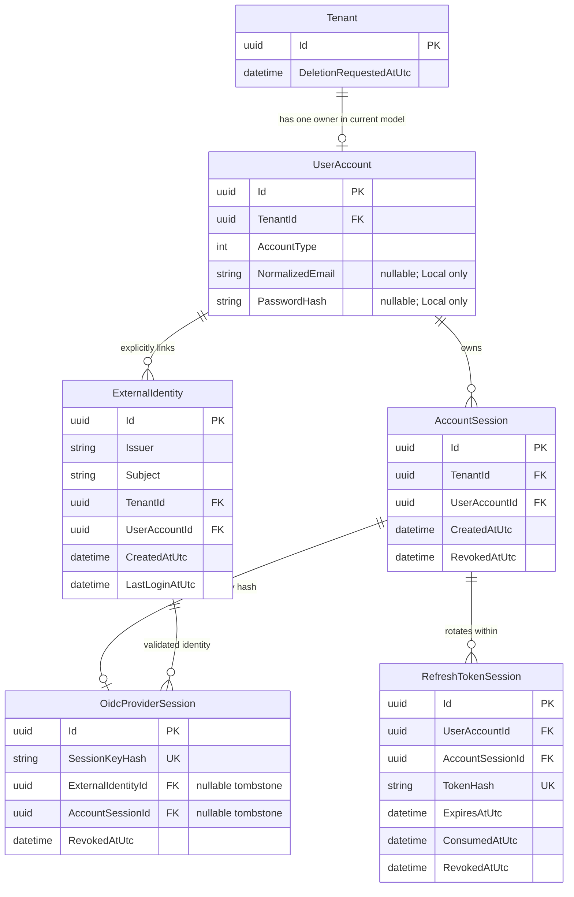
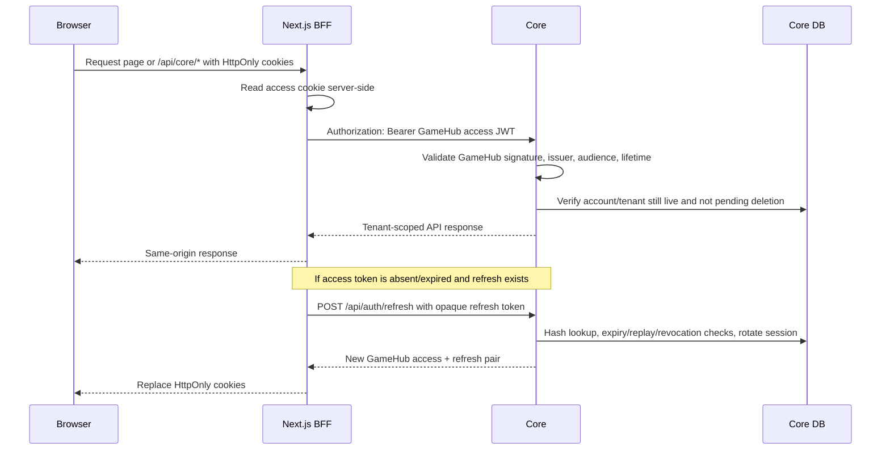

# GameHub OIDC Authentication Architecture

This document is a learning-oriented walkthrough of GameHub's production authentication path.
It explains the protocol, component boundaries, data model, source files, validation order,
failure behavior, and tests in enough detail to follow one login from the browser to a
tenant-authorized Core request.

The protocol decision is [ADR-011](adr/011-production-oidc-authentication.md); optional JIT
provisioning and external deletion reauthentication are defined by
[ADR-013](adr/013-personal-tenant-oidc-jit-provisioning.md).
Operational configuration is documented in [authentication.md](authentication.md). This guide
focuses on how and why the implementation works.

> **Important scope:** OIDC alone does not create accounts or enable production multi-user
> operation. ADR-012 adds a separate default-off operator gate. ADR-013 adds a second independent,
> default-off personal-tenant JIT mode; it is not public registration or general SaaS readiness.

## 1. The mental model

GameHub uses two related standards with different jobs:

- **OAuth 2.0 Authorization Code Flow** transports a short-lived authorization code from the
  identity provider to GameHub's callback and exchanges it server-to-server.
- **OpenID Connect (OIDC)** adds authenticated identity to OAuth. The provider returns a signed
  **ID token** containing an issuer (`iss`) and provider-stable subject (`sub`).

OAuth by itself does not answer “who signed in?” An OAuth access token primarily authorizes calls
to a provider-owned API. GameHub therefore requires the `openid` scope and validates the OIDC ID
token. It does not use the provider access token to authorize GameHub library APIs.

After validating the external identity, GameHub issues its own tokens:

| Artifact | Issuer | Consumer | Purpose |
|---|---|---|---|
| Authorization code | Identity provider | Next.js BFF | One-time input to the provider token endpoint |
| Provider ID token | Identity provider | Core, via the BFF | Cryptographic proof of `(issuer, subject)` |
| Provider access token | Identity provider | Not used by GameHub | Would authorize provider APIs, not GameHub APIs |
| GameHub access JWT | Core | Core APIs, forwarded by the BFF | Short-lived account and tenant authorization |
| GameHub refresh token | Core | Core refresh endpoint, called by the BFF | Rotating, revocable browser session continuation |

The central rule is:

```text
validated provider (issuer, subject)
    -> exact persisted mapping OR active opt-in personal JIT transaction
    -> server-owned GameHub UserAccount
    -> exactly one Tenant
    -> GameHub JWT containing the server-selected tenant_id
```

Email, display name, provider roles, organization claims, and tenant-like claims are never part of
that authorization chain.

## 2. Actors and responsibilities

| Actor | Owns | Must not own |
|---|---|---|
| Browser | Top-level navigation, provider UI, opaque cookies | Provider secrets, PKCE verifier, ID token validation, tenant choice |
| Next.js BFF | OIDC redirect protocol, state/nonce/PKCE, encrypted correlation cookie, code exchange, GameHub session cookies | Durable account/tenant mapping or final trust in ID-token claims |
| Identity provider | Primary authentication, credential recovery, MFA, email-verification policy, signed ID token | GameHub tenant selection or GameHub roles |
| Core | ID-token validation, external identity mapping, account/tenant state, GameHub JWT and refresh sessions | Provider password/MFA/recovery workflow |
| Core database | Unique identity ownership, composite account/tenant relationship, refresh-session state | Provider tokens or provider credentials |

## 3. Trust boundaries



There are three distinct proof transitions:

1. **Browser callback to BFF:** state, exact redirect, encrypted transaction, age, and PKCE
   correlation prove that the callback belongs to the BFF-created browser transaction.
2. **Provider ID token to Core:** signature, issuer, audience, lifetime, algorithm, nonce, and
   authorized-party checks prove the provider identity.
3. **External identity to tenant:** the persisted composite mapping proves which local account and
   tenant the identity may access.

Back-Channel Logout is a separate provider-to-BFF transition: the BFF accepts only the standard
form field and authenticates to Core, while Core validates the signed Logout Token before the exact
external identity or previously persisted hashed provider session may affect local state. `sid`
revokes one tenant-bound local family; `sub` without `sid` advances the account epoch. It never
reuses browser callback state or accepts a tenant from the provider request.

Skipping any one transition would create a different vulnerability. For example, a valid ID token
does not prove that the browser callback belongs to the initiating session, and a correct callback
does not prove which GameHub tenant the provider identity owns.

## 4. Source-code map

Read the implementation in this order:

1. [`frontend/lib/oidc-security.ts`](../frontend/lib/oidc-security.ts)
   - Generates state, nonce, verifier, and challenge.
   - Encrypts/authenticates the correlation transaction.
   - Performs callback correlation checks.
2. [`frontend/lib/oidc.ts`](../frontend/lib/oidc.ts)
   - Parses server-only BFF configuration.
   - Fetches discovery metadata and pins the configured issuer.
3. [`frontend/lib/oidc-logout-security.ts`](../frontend/lib/oidc-logout-security.ts),
   [`frontend/app/api/auth/logout/route.ts`](../frontend/app/api/auth/logout/route.ts),
   [`frontend/app/api/auth/oidc/backchannel-logout/route.ts`](../frontend/app/api/auth/oidc/backchannel-logout/route.ts), and
   [`frontend/components/LogoutButton.tsx`](../frontend/components/LogoutButton.tsx)
   - Derive the exact post-logout URI from server configuration.
   - Revoke and clear locally before an optional 303 RP-Initiated Logout navigation.
   - Prevent browser redirect input and provider logout without a refresh-session cookie.
   - Receive bodyless provider Back-Channel Logout requests and forward only the bounded token over
     the server-only BFF trust channel.
4. [`frontend/app/api/auth/oidc/start/route.ts`](../frontend/app/api/auth/oidc/start/route.ts)
   - Creates the transaction and redirects to the provider.
5. [`frontend/app/api/auth/oidc/callback/route.ts`](../frontend/app/api/auth/oidc/callback/route.ts)
   - Opens the transaction, checks the callback, exchanges the code, and delegates to Core.
6. [`services/core/Services/OidcTokenValidator.cs`](../services/core/Services/OidcTokenValidator.cs)
   and [`services/core/Services/OidcLogoutTokenValidator.cs`](../services/core/Services/OidcLogoutTokenValidator.cs)
   - Parses fail-closed Core configuration.
   - Retrieves discovery/JWKS metadata.
   - Validates the provider ID token.
   - Separately validates Back-Channel Logout signature, type, claims, freshness, and event shape.
7. [`services/core/Services/ExternalIdentityService.cs`](../services/core/Services/ExternalIdentityService.cs)
   - Explicitly links and exactly resolves `(issuer, subject)` mappings.
8. [`services/core/Controllers/AuthController.cs`](../services/core/Controllers/AuthController.cs)
   - Enforces the BFF-only boundary.
   - Orchestrates link/login and issues GameHub sessions.
9. [`services/core/Data/ExternalIdentity.cs`](../services/core/Data/ExternalIdentity.cs),
   [`services/core/Data/AccountSession.cs`](../services/core/Data/AccountSession.cs),
   [`services/core/Data/OidcProviderSession.cs`](../services/core/Data/OidcProviderSession.cs), and
   [`services/core/Data/CoreContext.cs`](../services/core/Data/CoreContext.cs)
   - Define database ownership, durable local families, issuer-bound hashed `sid` mappings, and
     uniqueness constraints.
10. [`frontend/lib/auth-session.ts`](../frontend/lib/auth-session.ts) and
   [`frontend/app/api/core/[...path]/route.ts`](../frontend/app/api/core/[...path]/route.ts)
   - Store, refresh, and forward the resulting GameHub session.
11. [`services/core/Services/MultiUserEnablementService.cs`](../services/core/Services/MultiUserEnablementService.cs),
    [`services/shared/Authentication/MultiUserMode.cs`](../services/shared/Authentication/MultiUserMode.cs),
    and [`frontend/lib/multi-user.ts`](../frontend/lib/multi-user.ts)
    - Keep OIDC readiness separate from immutable operator enablement.
    - Fail startup/routes closed on missing or contradictory prerequisites.
    - Restrict provisioned-tenant login, local linking, API-key compatibility, and background jobs.
12. [`services/core/Services/OidcJitProvisioningService.cs`](../services/core/Services/OidcJitProvisioningService.cs)
    - Creates a personal tenant, external account, mapping, refresh session, and activity row in
      one transaction only when both JIT and guarded mode are active.
13. [`services/core/Data/DeletedExternalIdentity.cs`](../services/core/Data/DeletedExternalIdentity.cs)
    - Prevents a deleted external subject from silently provisioning a replacement tenant.
14. [`services/core/Services/OidcBackChannelLogoutService.cs`](../services/core/Services/OidcBackChannelLogoutService.cs)
    and [`services/core/Services/AccountSessionValidationService.cs`](../services/core/Services/AccountSessionValidationService.cs)
    - Revoke one mapped local family for `sid`, or advance the mapped account epoch for `sub` only.
    - Enforce subject/session consistency, hashed race tombstones, and hashed replay markers.
    - Reject revoked local families and earlier access-JWT epochs during ordinary bearer validation.

## 5. Configuration flows through two servers

The same trust anchors are deliberately configured in both Next.js and Core, but the secret
material and responsibilities differ.

| Deployment variable | Next.js/BFF use | Core use |
|---|---|---|
| `GAMEHUB_OIDC_ENABLED` | Exposes the OIDC flow | Enables ID-token validation |
| `GAMEHUB_OIDC_PROVISIONING_MODE` | Parses `Disabled` or `PersonalTenantJit` | Authorizes JIT only together with active guarded mode |
| `GAMEHUB_OIDC_ISSUER` | Pins discovery issuer and constructs discovery URL | Pins discovery issuer and token `iss` |
| `GAMEHUB_OIDC_CLIENT_ID` | Sends OAuth `client_id` | Requires ID-token audience |
| `GAMEHUB_OIDC_CLIENT_SECRET` | Optional confidential-client token exchange | Never receives it |
| `GAMEHUB_OIDC_REDIRECT_URI` | Builds and verifies the callback | Never receives it |
| `GAMEHUB_OIDC_SCOPES` | Builds authorization request; must contain `openid` | Never receives it |
| `GAMEHUB_OIDC_COOKIE_KEY` | Encrypts correlation cookie | Never receives it |
| `GAMEHUB_OIDC_BFF_SERVICE_KEY` | Authenticates BFF calls to Core | Verifies BFF calls in fixed time |
| `GAMEHUB_OIDC_METADATA_ADDRESS` | Uses standard issuer discovery path | Optional explicit metadata location |
| `GAMEHUB_OIDC_ALLOWED_ALGORITHMS` | Not used for trust decisions | Closed asymmetric ID-token allowlist |
| `GAMEHUB_JWT_SIGNING_KEY` | Never receives it | Signs GameHub access JWTs |
| `GAMEHUB_MULTI_USER_ENABLED` | Enables the guarded BFF presentation only after its prerequisites pass | Activates provisioned-tenant admission only after Core readiness passes |

OIDC startup is fail-closed:

- Core parses `OidcSettings` during process startup. If OIDC is enabled but JWT signing, issuer,
  audience, HTTPS metadata, allowed algorithms, or BFF service key is invalid, Core does not start.
- The BFF parses its full configuration at both start and callback. Missing authentication,
  Secure-cookie mode, client, redirect, cookie key, or BFF key returns a generic unavailable result.
- OIDC never falls back to email matching or an unsigned local session.

The cookie key, BFF service key, provider client secret, and GameHub JWT signing key have different
purposes and must be generated independently. Key reuse would merge trust boundaries that are
intentionally separate.

## 6. The correlation transaction

`OidcTransaction` is the BFF's memory across the provider redirect:

| Field | Visible to provider? | Security role |
|---|---:|---|
| `state` | Yes | Correlates callback to browser transaction; prevents login CSRF |
| `nonce` | Yes, then signed in ID token | Correlates ID token to this authorization request |
| `codeVerifier` | No; token endpoint only | Secret PKCE proof held by BFF |
| `codeChallenge` | Yes | SHA-256 commitment to verifier bound to authorization code |
| `redirectUri` | Yes | Exact registered callback binding |
| `returnTo` | No | Sanitized local destination after success |
| `intent` | No | Server-owned choice between login and link |
| `createdAt` | No | Ten-minute replay/expiry boundary |

The transaction is serialized as JSON and sealed with AES-256-GCM:

```text
v1.<base64url 12-byte IV>.<base64url ciphertext>.<base64url 16-byte tag>
```

Why encryption as well as cookie flags?

- `HttpOnly` prevents normal browser JavaScript from reading the cookie.
- `Secure` restricts browser transport to HTTPS.
- `SameSite=Lax` permits the top-level cross-site provider callback while blocking most
  cross-site subrequests.
- AES-GCM protects against a browser/user changing `intent`, redirect, return path, nonce, or PKCE
  verifier and also hides those values from the browser storage layer.
- Associated data (`gamehub-oidc-transaction-v1`) binds the ciphertext to this protocol purpose.

## 7. First-time identity linking flow

With provisioning mode `Disabled`, OIDC login cannot succeed until an external identity is
explicitly linked to an existing GameHub account. This operator path never searches by email.

The user begins with a current full default-tenant session or a ten-minute local
`oidc_link_only` bootstrap session issued to an unlinked operator-provisioned account:

```http
GET /api/auth/oidc/start?intent=link&returnTo=/admin
```



The destination account and tenant come only from the existing GameHub JWT. A link-purpose JWT is
accepted only on this exact POST route and has no refresh session. The linking request
contains no account ID or tenant ID, and provider claims cannot override them.

The operation is idempotent for the same exact mapping. It rejects:

- an issuer/subject already owned by another account;
- a different subject from the same issuer already linked to this account;
- an unavailable or pending-deletion account;
- a cross-tenant combination rejected by the composite database foreign key.

## 8. Normal OIDC login flow

After linking, the BFF clears any local bootstrap cookie. The login page then navigates to:

```http
GET /api/auth/oidc/start?returnTo=/library
```



### Detailed validation order in Core

`OidcTokenValidator.ValidateAsync` applies these gates:

1. OIDC must be enabled through validated startup configuration.
2. ID-token and nonce sizes are bounded before parsing or cryptography.
3. Discovery/JWKS metadata must be obtainable over HTTPS within the timeout.
4. Discovery issuer must exactly match configured issuer and contain signing keys.
5. JWT signature must validate with a configured asymmetric algorithm.
6. Token issuer must exactly match the configured issuer.
7. Audience must include the configured GameHub client ID.
8. `azp` must identify GameHub whenever required by OIDC multiple-audience rules.
9. `exp` is required; lifetime and clock skew are enforced.
10. `sub` must be present and bounded.
11. Signed token `nonce` must exactly match the BFF transaction nonce.
12. A supplied `sid` must be a bounded string.
13. The validator projects only issuer, subject, optional display email, fresh-authentication time,
    and the opaque session ID needed for immediate one-way hashing.

If the token references a signing key not present in the current cache, Core requests exactly one
metadata refresh. This supports normal provider key rotation without creating unbounded network
retries. Every other validation failure remains closed.

### Personal-tenant JIT branch

After the same ID-token validation, an unknown identity takes one additional branch:

```text
unknown exact (issuer, subject)
    -> provisioning mode is PersonalTenantJit
    -> guarded multi-user mode is active
    -> no deleted-identity tombstone exists
    -> begin Core database transaction
    -> generate tenant/account/mapping/session identifiers on the server
    -> create sync-disabled Tenant + ExternalOidc UserAccount
    -> create exact ExternalIdentity + RefreshTokenSession + tenant ActivityLog
    -> commit all rows or roll back all rows
```

The unique issuer/subject index resolves concurrent first login. The losing request can load the
winner or return the generic authentication failure, but its transaction cannot leave partial
rows. Email and all provider authorization/profile claims remain outside this branch.

If the mode is disabled, guarded mode is off, OIDC is unavailable, or the subject has a deletion
tombstone, the result is the same generic unknown-identity response.

## 9. Why state, nonce, and PKCE are all required

These values are related but not interchangeable:

| Mechanism | Compared by | Primary attack it addresses |
|---|---|---|
| `state` | BFF callback vs sealed transaction | Login CSRF and callback injection |
| Exact redirect URI | BFF and provider | Code delivery to the wrong origin/path |
| PKCE verifier/challenge | BFF locally and provider token endpoint | Stolen/intercepted authorization code |
| `nonce` | Core vs signed ID-token claim | ID-token substitution/replay across authorization transactions |

Example: an attacker may possess a valid ID token for their own provider account. That does not
give them the sealed transaction cookie, matching state, private verifier, or another subject's
database mapping. Conversely, a stolen authorization code cannot be exchanged without the private
verifier, even if the attacker knows the public challenge.

## 10. Core identity and tenant data model



Relevant database invariants:

- Unique `(Issuer, Subject)` means one provider identity has one GameHub owner.
- Unique `(UserAccountId, Issuer)` prevents implicit subject replacement at a provider.
- Composite FK `(TenantId, UserAccountId) -> UserAccount(TenantId, Id)` prevents constructing a row
  with Account A and Tenant B.
- Normal access JWTs and rotating refresh rows share one stable `AccountSession`; rotation never
  replaces the stable family.
- Unique issuer-bound `SessionKeyHash` orders concurrent login/logout first writers without storing
  raw provider session IDs.
- OIDC provider-session mappings use composite identity/session ownership keys; `sid` never directly
  chooses an account or tenant.
- No email or provider profile data participates in the relationship.
- Local accounts require non-empty email, normalized email, and password hash. External accounts
  require null normalized email and password hash; the normalized-email unique index is filtered
  to local accounts on SQLite and PostgreSQL.
- Deleted external issuer/subject tombstones have no account or tenant relationship and block JIT
  recreation after completed account deletion.

`ExternalIdentity` is deliberately not behind a tenant query filter because login starts before a
tenant is trusted. That makes the exact global issuer/subject lookup security-sensitive; trust is
established only after the mapping and its account/tenant relationship are loaded.

## 11. GameHub session after OIDC

OIDC ends when Core creates a normal GameHub session. From that point onward, API authorization is
identical to local-account login:



The browser cannot read either GameHub token because both cookies are HttpOnly. The BFF converts
the access cookie into an `Authorization: Bearer` header for Core. A refresh token is random opaque
data; Core stores only its SHA-256 hash and rotates it on every successful refresh.

## 12. Cookie and secret inventory

| Value | Stored where | Browser-readable? | Lifetime/use |
|---|---|---:|---|
| OIDC transaction cookie | Browser, encrypted/authenticated | No (HttpOnly) | Maximum 10 minutes; deleted after callback |
| OIDC cookie key | Next.js server configuration | No | Encrypts only correlation transactions |
| Provider client secret | Next.js server configuration | No | Optional confidential-client authentication |
| BFF service key | Next.js and Core server configuration | No | Authenticates internal OIDC exchange/link calls |
| Provider ID token | BFF memory, then Core request | No | One callback; never stored in GameHub DB/cookies |
| GameHub access JWT | Browser cookie | No (HttpOnly) | Short-lived Core authorization |
| GameHub refresh token | Browser cookie | No (HttpOnly) | Rotating session secret; hashed in Core DB |
| GameHub JWT signing key | Core server configuration | No | Signs/verifies GameHub access JWTs |

`Secure=true` is mandatory for OIDC. `SameSite=Lax` is used because the provider returns through a
top-level cross-site navigation; `Strict` would commonly suppress the callback cookie. The
correlation cookie uses path `/api/auth/oidc`, while GameHub session cookies use `/` because the BFF
needs them for page and API requests.

## 13. Failure behavior

| Failure | Detection point | External behavior | Security reason |
|---|---|---|---|
| Missing/invalid OIDC config | Core startup or BFF route | Startup failure or 503 | Never run partially configured auth |
| Provider discovery unavailable | BFF/Core | Generic unavailable/failed login | No cached/unsigned claim fallback |
| Provider token endpoint unavailable | BFF | Generic failed login | No session without completed code exchange |
| Wrong state | BFF callback | Generic failed login | Reject callback not initiated by browser transaction |
| Wrong callback origin/path | BFF callback | Generic failed login | Enforce registered redirect boundary |
| Wrong/altered verifier | BFF and provider | Generic failed login | Reject intercepted code or altered transaction |
| Wrong nonce | Core | Generic 401 through callback | Reject token from another authorization transaction |
| Wrong issuer/audience/algorithm/signature | Core | Generic 401 | Reject untrusted token authority or client |
| Unknown issuer/subject mapping | Core mapping | Same generic 401 | Avoid identity/account enumeration |
| Email collision | Core mapping | No fallback; generic 401 | Prevent automatic account takeover |
| Pending-deletion account | Core mapping/JWT validation | Generic 401 | Lifecycle state is immediately fail-closed |
| Deleted account | DB cascade and mapping lookup | Generic 401 | Identity cannot recreate deleted ownership |
| Wrong/missing BFF service key | AuthController | Generic 401 | Prevent direct bypass of BFF protocol checks |
| Invalid Back-Channel Logout Token | Core logout validator | Bodyless 400 through BFF | Reject forged, stale, replay-shaped, or cross-JWT messages before identity lookup |
| Valid token with disagreeing `sub` and mapped `sid` | Core logout service | Bodyless 400 through BFF | Change neither tenant; reject inconsistent provider session ownership |
| Back-channel discovery/JWKS unavailable | Core logout validator | Bodyless retryable 503 through BFF | Never accept unsigned claims during provider outage |

The callback always expires the transaction cookie, whether authentication succeeds or fails.
Public errors intentionally do not reveal which check failed or whether an identity is linked.

## 14. Provider outage and signing-key rotation

The BFF applies a ten-second timeout to discovery and token calls. Core's metadata HTTP client also
uses a ten-second timeout. New login/link attempts fail closed when the provider is unavailable.
Logout independently completes local revocation/cookie cleanup and falls back to `/login` when
discovery or its optional HTTPS `end_session_endpoint` is unavailable.

Already-issued GameHub sessions are independent of provider availability:

- Existing access JWTs remain valid until their normal short expiry, subject to Core's live
  account/pending-deletion/session-epoch/local-family database check.
- Existing GameHub refresh rows rotate within the same local family without contacting the provider.
- A valid Back-Channel Logout revokes the exact `sid` family, or advances the exact account epoch
  and revokes all families when only `sub` is present. Other provider recovery/MFA/disabled-user
  changes do not retroactively revoke GameHub sessions unless the provider emits that logout;
  general provider event synchronization is not implemented.

For provider signing-key rotation, `ConfigurationManager` caches discovery/JWKS data. A
`SecurityTokenSignatureKeyNotFoundException` triggers one forced refresh and one revalidation.
Other failures do not trigger refresh loops.

## 15. Account lifecycle interaction

### Pending deletion

Pending-deletion accounts cannot:

- authenticate through an external mapping;
- link a new identity;
- use ordinary GameHub access JWTs;
- rotate refresh sessions.

Only the signed deletion retry path remains available under ADR-010.

### Completed deletion

Before deleting `UserAccount`, Core stores the exact issuer/subject in
`DeletedExternalIdentity`. The live mapping and refresh sessions then cascade with the account. A
later provider login finds the tombstone and returns the generic authentication failure; JIT does
not recreate the account or tenant.

### External deletion reauthentication

The BFF owns a distinct `delete` OIDC transaction. It adds `prompt=login` and `max_age=0` while
retaining state, nonce, PKCE, exact callback, and sealed-cookie checks. Core repeats normal token
validation, requires a signed `auth_time` no more than five minutes old, and resolves the exact
mapping to the current external account. It then issues a ten-minute
`account_deletion_only` GameHub token.

The bearer boundary accepts that token only on `DELETE /api/auth/account`. The BFF consumes it
server-to-server immediately, so neither provider tokens nor the restricted GameHub token reach
browser JavaScript or `localStorage`. A `delete-retry` transaction can repeat this proof for an
already pending account after a cross-service cleanup failure.

### Provider recovery

Password recovery, MFA recovery, and email verification belong to the trusted provider. Successful
provider recovery restores the ability to prove the same `(issuer, subject)`; it does not change
the GameHub mapping. The local compatibility password has no public recovery flow.

## 16. Why GameHub never links by email

Email is unsuitable as the stable external identity key because:

- a provider may allow address changes;
- different providers can assert the same address;
- provider tenants/directories may reuse addresses;
- `email_verified` semantics and policies vary;
- an address may be recycled to another person;
- accepting a new issuer/subject because its email matches an existing account converts provider
  policy mistakes into GameHub account takeover.

OIDC defines `sub` as the locally unique, never-reassigned identifier for the end user at an
issuer. GameHub therefore stores the exact `(iss, sub)` pair and treats email as optional display
metadata only.

## 17. Test coverage mapped to threats

### Core tests

[`tests/GameHub.Tests/OidcAuthenticationTests.cs`](../tests/GameHub.Tests/OidcAuthenticationTests.cs)
covers:

- valid signature/issuer/audience/nonce identity projection;
- wrong issuer, audience, nonce, and signing algorithm;
- provider metadata outage;
- incomplete or unsafe OIDC configuration;
- same email under different subjects/issuers without auto-linking;
- Tenant A being unable to claim Tenant B's identity;
- manipulated cross-tenant database relationships;
- pending-deletion and deleted account rejection.
- fresh signed `auth_time` for deletion reauthentication.

[`tests/GameHub.Tests/OidcJitProvisioningTests.cs`](../tests/GameHub.Tests/OidcJitProvisioningTests.cs)
covers default-off/gate-off behavior, atomic personal creation, missing and equal email claims,
server-generated ownership, sync-disabled policy, parallel first login, tombstones, external local
credential rejection, database constraints, and zero-account read-only readiness.

[`tests/GameHub.Tests/AuthControllerTests.cs`](../tests/GameHub.Tests/AuthControllerTests.cs) proves
that direct Core callers without the BFF key cannot exchange an ID token.

SQLite and real PostgreSQL upgrade preservation are covered in:

- [`tests/GameHub.Tests/TenantIsolationTests.cs`](../tests/GameHub.Tests/TenantIsolationTests.cs)
- [`tests/GameHub.Tests/PostgresTagRelationshipMigrationTests.cs`](../tests/GameHub.Tests/PostgresTagRelationshipMigrationTests.cs)

They verify that existing local accounts, email/password hashes, external mappings, refresh
sessions, default tenant, pending-deletion state, unified games, and library items survive the
account-type migration on SQLite and real PostgreSQL.

### BFF tests

[`frontend/tests/oidc-security.test.mjs`](../frontend/tests/oidc-security.test.mjs) directly tests:

- encrypted transaction round-trip;
- wrong state;
- wrong callback redirect;
- wrong PKCE verifier;
- tampered authenticated cookie;
- expired transaction.

## 18. Safe debugging checklist

Never print provider client secrets, BFF service keys, cookie keys, authorization codes, ID tokens,
GameHub access tokens, refresh tokens, or decrypted correlation transactions.

When diagnosing a failed login, check non-secret facts in this order:

1. Is OIDC explicitly enabled in both frontend and Core configuration?
2. Is frontend authentication enabled and Secure-cookie mode true?
3. Does the configured issuer exactly equal the discovery document's issuer, including path and
   trailing slash?
4. Does the provider registration contain the exact external HTTPS callback URL?
5. Does the reverse proxy preserve external scheme and host for `request.url`?
6. Does the requested scope include `openid`?
7. Is the GameHub client ID the ID-token audience and, when applicable, authorized party?
8. Is the provider's actual signing algorithm in Core's explicit allowlist?
9. Are browser time, Core time, and provider time reasonably synchronized?
10. Was the external identity explicitly linked before normal OIDC login?
11. Is the linked GameHub account live rather than pending deletion?

Useful safe signals include HTTP status, exception category, configured issuer hostname, key ID
(`kid`), algorithm name, and whether a mapping exists. Token bodies and secrets are not safe logs.

## 19. Provider integration checklist

Before enabling a provider:

- Register an OIDC client with Authorization Code Flow.
- Require PKCE with `S256` if the provider exposes such a policy switch.
- Register only the exact GameHub HTTPS callback URI.
- Select a trusted issuer and verify its discovery metadata/JWKS behavior.
- Choose the minimum scopes; `openid` is mandatory, while `profile`/`email` are optional for display.
- Choose and configure an asymmetric ID-token algorithm supported by both provider and Core.
- Configure provider MFA, recovery, email verification, abuse controls, and administrative access.
- Generate independent cookie, BFF service, and GameHub JWT keys outside the repository.
- Verify reverse-proxy forwarded host/protocol behavior.
- Bootstrap the existing GameHub owner and explicitly link the provider identity.
- Run login, logout, refresh, pending-deletion, provider-outage, and key-rotation exercises.
- Register and exercise the exact public Back-Channel Logout URL, including cross-tenant checks.
- Require session-bearing Back-Channel Logout at the provider, save the client, and sign in again
  before testing so a new hashed `sid` mapping exists.
- Keep guarded multi-user enablement disabled until ADR-012 readiness and the operator rollout
  checklist are complete.

## 20. Known boundaries and future work

- One issuer/client configuration is supported per deployment.
- Personal-tenant JIT exists only through its explicit default-off provisioning mode and active
  guarded mode; it is not public registration.
- There is no unlink or subject-replacement flow.
- RP-Initiated browser logout and provider-neutral `sid`/`sub` Back-Channel Logout are implemented
  without storing provider tokens or raw provider session IDs. Provider disabled-user event
  reconciliation is not implemented.
- Provider access tokens are not retained or used for provider APIs.
- Local account deletion still follows ADR-010's current-password confirmation path.
- Guarded multi-user enablement is implemented, deliberately separate, and disabled by default.
- Active mode is self-hosted guarded operation, not public registration or unrestricted SaaS
  readiness.

These boundaries are intentional. Expanding them safely requires new decisions about
reauthentication, recovery, administrative authority, tenant creation, provider event trust, and
cross-tenant rollout controls—not merely additional buttons in the frontend.

## 21. Guarded admission after OIDC validation

OIDC proof and GameHub multi-user admission remain separate checks:

```text
valid OIDC ID token
    -> exact persisted issuer/subject mapping OR permitted atomic personal JIT
    -> live account and tenant
    -> default tenant OR immutable multi-user switch enabled
    -> GameHub access/refresh session
```

While the switch is false, a valid mapping for a provisioned tenant still receives the same generic
authentication failure. The default tenant remains available for upgrade-compatible single-user
OIDC. When the switch is true, Core has already validated complete OIDC/JWT/BFF/operator/Ingest and
Frontend configuration at startup and verified that every live account is linked.

Core's active-mode default authorization policy accepts only GameHub JWTs. The API key is limited
to endpoints that explicitly declare operator authentication. Ingest's active-mode default policy
accepts only Core tenant delegation. Background sync and enrichment enumerate provisioned tenants
only while the switch is enabled; disabling it leaves their rows intact but dormant.

Existing GameHub sessions do not contact the provider on every request. Enabling or disabling the
gate does not rewrite or revoke them; they continue under ADR-011 until normal expiry/revocation,
subject to the live-account and pending-deletion database check. See
[Guarded Multi-User Operations](guarded-multi-user-enablement.md) for rollout and recovery.
